  

  

  
  
  
  

 

## ⚡ About me

- 🔭 Senior Frontend Engineer at **[Riverbed](https://www.riverbed.com/)**: sole frontend engineer on the Agent Lifecycle Management Platform, and maintainer of the shared design system and its Storybook docs, used across all Aternity products.
- 🤖 I run delivery with an AI workflow I designed: **Claude Code agents connected over MCP** to Jira, Bitbucket and the browser take each ticket from plan to code to tests to PR.
- 🌱 Currently building an **AI agent that migrates Angular apps to React + TypeScript**.
- 💬 Ask me about frontend architecture, design systems, AI agents and MCP.

 

## 🧠 AI engineering

  
  
  
  
  

## 🛠️ Tech stack

  

  
  
  
   

 

## 🚀 Featured project

  

MCP server that connects Claude to WhatsApp (Go + Python). Forked from lharries/whatsapp-mcp and extended with Claude Code: group management tools, quoted replies, security hardening and tests.

 

## 📈 GitHub stats

  
  

  

  <picture>
    <source media="(prefers-color-scheme: dark)" srcset="https://raw.githubusercontent.com/BenGedi/BenGedi/output/github-snake-dark.svg" />
    <source media="(prefers-color-scheme: light)" srcset="https://raw.githubusercontent.com/BenGedi/BenGedi/output/github-snake.svg" />
    
  </picture>

